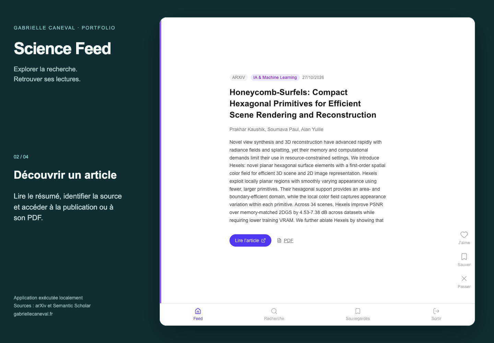

# Science Feed

Application de découverte d’articles scientifiques construite avec Next.js, TypeScript, Auth.js, Prisma et SQLite.

## Fonctionnalités implémentées

- Création de compte et connexion par identifiants.
- Choix des centres d’intérêt, fil chronologique et exclusion des articles déjà vus.
- Ingestion et recherche via arXiv et Semantic Scholar.
- Interactions : aimer, enregistrer et passer un article.

La personnalisation repose sur les centres d’intérêt et les interactions, sans moteur de recommandation LLM. Les articles sont identifiés par leur source et leur identifiant externe ; le dédoublonnage entre fournisseurs n’est pas garanti.

## Lancement local

Node.js 22 LTS recommandé pour les dépendances Prisma et SQLite natives.

```sh
npm ci
cp .env.example .env
# Remplacer DATABASE_URL par le chemin absolu de prisma/dev.db, préfixé par file:.
# Remplacer AUTH_SECRET par un secret aléatoire personnel.
# Exemple de génération : openssl rand -base64 32
npm run db:generate
npm run db:migrate
npm run db:seed
npm run dev
```

Ouvrir http://localhost:3000 et créer un compte de test. La base locale et les secrets sont ignorés par Git. Le seed initialise les centres d’intérêt, sans publier de comptes utilisateur.

## Vérifications

```sh
npm run lint
npm run build
```

La compilation utilise Webpack. Vérifiés : génération Prisma, migration SQLite, initialisation des 12 intérêts, analyse ESLint et compilation TypeScript/Next.js. Les flux externes ne sont pas couverts par ces vérifications.

## Limites

Prototype personnel. Les API externes peuvent être indisponibles ou limiter le débit. Certaines erreurs d’ingestion sont tolérées et peuvent produire un fil vide. SQLite est utilisé localement ; un hébergement persistant et une politique de protection des comptes seraient nécessaires avant un usage public. Les résumés et liens restent attribués aux fournisseurs scientifiques.

## Droits

Aucune licence de réutilisation n’est accordée pour le code de ce dépôt. Les dépendances tierces conservent leurs propres licences.

## Démonstration vidéo

[](docs/media/science-feed-demo.mp4)

[Lire ou télécharger la vidéo MP4 (31 secondes)](docs/media/science-feed-demo.mp4) · [Sous-titres français](docs/media/science-feed-demo.fr.vtt) · [Parcours et conditions](docs/demo.md)

La vidéo montre le choix IA & Machine Learning, le flux, la sauvegarde d’un article et sa présence dans la bibliothèque, puis une recherche « graph neural networks » qui a renvoyé 15 résultats réels pendant la capture. Le compte est un compte local de test. Le flux est préparé avec refillInterest, via les connecteurs arXiv et Semantic Scholar du projet ; aucune réponse API n’est simulée. La disponibilité et les quotas des sources peuvent faire varier les résultats.
